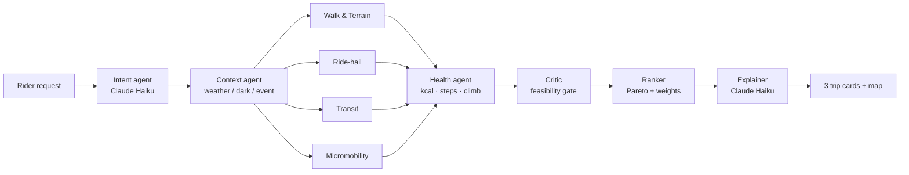

# Hopper — SF multimodal commute prototype

Uber-style trip planner that mixes **walk + ride-hail + Muni/BART/cable car + Bay Wheels**
in one trip, and ranks options by **time, cost, and health** (kcal, steps, climb).
San Francisco only.

## Run

```bash
cd hopper
PORT=5080 python3 -m app.server        # needs flask + anthropic
```

Open http://localhost:5080. With `ANTHROPIC_API_KEY` set, the Intent and Explainer agents
use Claude (`claude-haiku-5-5`); without it (or with `HOPPER_OFFLINE=1`) they fall back to
a rule parser and templates. Every number is identical in both modes.

## Abuse protection and cost control

- **Per-visitor rate limits** (sliding windows; HTTP 429 + `Retry-After` when exceeded):

  | Endpoint | Limit |
  |---|---|
  | `/api/plan` | 20 / min, 200 / hour |
  | `/api/flights` | 5 / min, 30 / hour |
  | `/api/crawl` | 10 / min, 60 / hour |
  | sign-in / sign-up | 10 / min, 60 / hour per IP (plus the 5-failures-per-email lockout) |
  | `/api/rerank`, `/api/ride-options`, search, account changes | 60–120 / min |

  The visitor is the connection's IP; `X-Forwarded-For` is trusted only with
  `HOPPER_TRUST_PROXY=1` (set it only behind a proxy you control).
- **Claude budget**: `HOPPER_CLAUDE_DAILY_CAP` (default 400 calls/day for the whole app) and
  `HOPPER_CLAUDE_VISITOR_DAILY_CAP` (default 40/visitor). Past either, plans silently use the
  rules + templates fallback — same numbers — and the agent trace says "Cost guard".
- **Security headers** on every response: a strict Content-Security-Policy (the page's one
  inline script is allowed by its SHA-256 hash, computed at startup; only unpkg, Google Fonts,
  OpenFreeMap, Esri, and Duffel logo hosts are allowed), `X-Content-Type-Options: nosniff`,
  `X-Frame-Options: DENY` + `frame-ancestors 'none'`, `Referrer-Policy`, `Permissions-Policy`,
  `Cross-Origin-Opener-Policy`, HSTS over HTTPS, and `Cache-Control: no-store` on the API.
- **Hardening**: 64 KB request-body cap; internal flags (keys starting with `_`, e.g.
  `_quick`, `_visitor`) are stripped from browser requests.
- Counters are in memory per process (fine for this prototype; use Redis for several instances).

## Choosing a ride

When the selected trip includes a ride, "Choose a ride" opens a ride chooser: Go, Shared,
Green, Comfort, XL, Premium, and Taxi, each with seats, pickup time, local drop-off time, and
a fare range, cheapest first. Shared pauses late at night and in heavy surge; Premium is
sometimes fully booked; Taxi is metered and never surges. **All of this is simulated**:
Uber and Lyft don't offer public price APIs, so the chooser also has "Compare in Uber" and
"Compare in Lyft" buttons that open the real apps (public universal links) with pickup and
drop-off filled in. Generic tier names on purpose. Confirming saves the chosen type and its
price to trip history.

## Flights (door to door)

Trips over ~100 miles switch to flights instead of failing:

- Airports: 3,244 scheduled-service airports from **OurAirports** (public domain, bundled in
  `app/fixtures/airports.json`); the 3 nearest each side, big hubs preferred.
- Each option = ground trip to the airport (planned by the normal swarm in your Mode: BART
  to SFO in Broke, a ride in Hustle) + check-in buffer (90 min domestic / 150 international)
  + flight + arrival buffer (25 / 50) + ground trip from the airport. Hustle/Burn rank by
  door-to-door time, Broke by price.
- **Real offers with Duffel**: put `DUFFEL_API_KEY` in `hopper/.env` (Duffel dashboard →
  Developers → Access tokens). Hopper queries the 3 most promising airport pairs in parallel
  (one-way, 1 adult, economy, ≤ 1 connection; cached 10 min) and shows the cheapest and
  fastest offer per pair: airline, flight numbers, local departure/arrival times, stops, and
  the real price in its currency, plus "Leave home by …, at your door by …" computed from the
  real departure time. A `duffel_test_…` key returns Duffel's sandbox airline and is labelled
  "Duffel test mode". The key is only read server-side and never logged, cached by, or sent
  to the browser (tested). Selecting an offer saves it to trip history; actual booking needs
  passenger details and payment, which Hopper doesn't collect.
- **Without a key (or if Duffel fails)** flight times and fares are estimates from
  great-circle distance, and the UI says so ("Estimated fares"). Every option links to
  **Google Flights, Skyscanner, and Kayak** prefilled with the airports and date.

## Worldwide

Hopper plans trips in any city. San Francisco keeps its richer local stack; everywhere else
uses free global sources (no API keys):

| Piece | San Francisco | Everywhere else |
|---|---|---|
| Transit | Hand-built Muni/BART/cable lines + 511 live arrivals | **Transitous** (api.transitous.org) — worldwide GTFS routing, live times where agencies publish them, agency line names and colours. No fares, so transit cost is a flat estimate |
| Bike share | Bay Wheels GBFS | **CityBikes** (~800 networks); picks the network with the most bikes within 0.7 km |
| Weather | NWS (any US trip) | **Open-Meteo** (also supplies the local time zone) |
| Elevation | USGS EPQS (US) | Open-Meteo elevation |
| Ride-hail walk-ahead pickups | SF landmarks | Points sampled along the real walking route |
| Bars (Bar Crawl) | Bundled snapshot | Live Overpass search around the start |
| Walk / bike / drive routes | OSRM | OSRM |

- Times are in the trip city's own time zone ("Leave now" = now there). Distances show in
  miles for the US/UK and km elsewhere. Prices outside the US are rough USD estimates.
- Trips must be within ~100 miles (city/metro trips); "Explore another city" re-centres the
  map so address search favours that city.
- Outside SF the plain-English parser never fuzzy-matches SF landmarks; it geocodes the
  rider's words near where the map is.
- The FOSSGIS OSRM servers rate-limit bursts. When they refuse, Hopper pauses OSRM for 5
  minutes and uses **OpenRouteService** if `ORS_API_KEY` is set (free: 2,000 routes/day; key
  sent only in the Authorization header). With neither, legs fall back to straight-line
  estimates ("Estimated routes"). For heavy use, run your own `osrm-backend` (`OSRM_BASE_URL`).

## Map

Vector basemap from **OpenFreeMap** (no key) rendered by **MapLibre GL 5.24** inside Leaflet,
restyled at load for a ride-app look: cool-gray land, white streets, blue-gray highways, blue
water, transit-stop and place icons, labels that follow the streets. Dark mode uses
OpenFreeMap's dark style. Devices without WebGL fall back to Esri's gray raster canvas.

## Place search

"Pickup" and "Where to?" are search boxes, not dropdowns. Suggestions come from your current
location, saved places, recent trips, the built-in landmarks, and live address search via
**Photon** (OpenStreetMap, no key, limited to San Francisco + SFO). Any SF address becomes a
temporary `geo:<lat>,<lon>` place the whole planner understands; its elevation comes from
the **USGS Elevation Point Query Service** so hill and calorie math still works. Plain-English
requests with addresses ("from 500 Folsom St to Coit Tower") are geocoded the same way.

## Accounts, saved places, trip history

- Sign up / sign in from the header. Accounts live in SQLite at `data/hopper.db`
  (git-ignored). Passwords are salted scrypt hashes; sessions are signed, HttpOnly,
  SameSite=Lax cookies. The signing key comes from `HOPPER_SECRET_KEY` or is generated once
  into `data/.secret_key`.
- Saved places: one Home, one Work, plus up to 25 custom labels; they show as one-tap
  shortcuts and at the top of search suggestions.
- Trip history: booking (demo) saves the trip; the account sheet lists trips with
  "Plan again" and "Clear trip history".
- Signed out, recent searches are still remembered in this browser (localStorage).
- Safeguards: JSON-only state changes, generic login errors, 5 failed logins per 15 min
  per email, per-user data isolation (all covered by tests).

## Modes

Pick one at the top (or let the Intent agent infer it from your question):

| Mode | Goal | Rules on top of the Critic |
|---|---|---|
| ⚡ **Hustle** | Fastest | Walk ≤ 0.4 mi per leg, ≤ 0.8 mi total; weights time 3 · cost 0.5 · health 0 |
| 💸 **Broke** | Budget | Walk ≤ 1.5 mi per leg; ride-hail only if nothing else works; ≤ 2.5× the fastest *transit* trip; price first (calories don't count) |
| 🍸 **Bar Crawl** | Hit cool bars | 21+ gate; 2–5 stops; walk-only hops (≤ 0.5 mi, ≤ 0.25 mi in rain); simulated ride home |
| 🔥 **Burn** | Part transit / part workout | Must include a transit leg AND ≥ 40% active minutes; ≤ 2× the fastest *transit* trip |

- Plans are built once with the loosest limits; switching Hustle / Broke / Burn re-runs only
  the Ranker on cached trips (`/api/rerank` with `mode`). "Advanced" sliders = Custom mode.
- If nothing meets a Mode's rules, the closest options are shown with a notice.
- **Bar Crawl** (`/api/crawl`) uses OpenStreetMap bars — live from Overpass (cached 7 days),
  falling back to the bundled snapshot `app/fixtures/sf_bars.json` (497 bars, © OpenStreetMap
  contributors, ODbL). OSM has **no ratings**: the cool score uses landmark status
  (Wikipedia/Wikidata), how thoroughly the bar is mapped, website / Instagram / hours,
  outdoor seating, and your vibe (cocktail, craft beer, dive, wine, live music, sports,
  LGBTQ+, landmarks). Opening hours are shown, not validated — check before you go.

Tests: `pip install -r requirements.txt && HOPPER_OFFLINE=1 python3 -m pytest -q tests`
(no network — live feeds are tested with sample payloads). GitHub Actions runs the same
suite on Python 3.12 for every push and pull request that touches `hopper/`
(`.github/workflows/hopper-tests.yml`).

## Live data (free, no Google)

| Feed | Used for | Key | Fallback |
|---|---|---|---|
| **511 SF Bay** StopMonitoring + service alerts | Real Muni/BART/cable-car wait times; ⚠ alert flags on trips | `FIVE11_API_KEY` (free: https://511.org/open-data/token) | Schedule headway ÷ 2 |
| **NWS** api.weather.gov | Hourly forecast at the origin → rain/fog/clear, wind (> 20 mph turns bikes off) | none | Assume clear (or pick weather manually) |
| **Bay Wheels GBFS** | Real classic / e-bike counts and open docks at the nearest station | none | Deterministic pseudo-availability |
| **OSRM** (routing.openstreetmap.de foot / bike / car) | Real street routes for walk, bike, and ride legs: distance, drive time (× traffic factor 1.35, 1.8 at rush hour), and the polyline drawn on the map | none | Straight-line estimates |

**Routing flow:** the Critic first prunes candidates on cheap estimates; surviving trips and
the door-to-door baseline get OSRM street routes (4 in parallel, ≤ 60 unique legs per plan,
cached on disk for a day); then Health and the Critic re-run on the real distances before
ranking — so cards, labels, explanations, and the map all use the street route.
The FOSSGIS servers are a shared community service: keep volume low, or point
`OSRM_BASE_URL` at your own `osrm-backend`. `HOPPER_NO_OSRM=1` turns routing off.

- Put keys in `hopper/.env` (see `.env.example`; git-ignored). Real env vars win.
- Live arrivals and docks are used only when the trip leaves **this hour** (SF time);
  future hours use schedules.
- 511's free tier is ~60 calls/hour: stop lists are cached on disk for a day, arrivals for
  90 s, alerts for 10 min; at most 4 arrival lookups per plan; a rolling budget
  (`FIVE11_HOURLY_BUDGET`, default 50) stops calls before 511 refuses them.
- `HOPPER_OFFLINE=1` turns off every live feed and Claude.
- The UI shows a weather strip and badges saying which sources were live for each plan.

## Agent swarm



- **LLM agents do language** (understand the request, explain the trade-off).
- **Deterministic tools do numbers** (`app/tools.py`): fares, minutes, calories, ranking,
  validation. The Critic rejects any leg whose numbers weren't produced by a tool.
- Specialists fan out in parallel. Moving the sliders re-runs **only the Ranker** (`/api/rerank`).
- The UI's "Agent swarm trace" panel shows each agent's model, latency, and tokens.

## Agent evals

`evals/` grades the swarm's answers, not just its code. The checks judge each plan
against a written spec in `evals/cases.json`, never by calling the planner's own logic.

```bash
python -m evals.run                    # offline, deterministic, free (CI runs this on every push)
python -m evals.run --live             # also grades Claude's Intent + Explainer (needs ANTHROPIC_API_KEY)
python -m evals.run --update-golden    # re-record golden.json after an intended routing change
python -m evals.run --record           # re-fetch the world-feed cassette (network), then re-record golden
```

| Suite | What it checks |
|---|---|
| integrity | every option is one connected journey from the origin to the destination, with no negative numbers |
| explanation | **grounding** (every number in the one-liner is in the facts) + **faithfulness** ("saves $X", "+N min", "N min faster", "+N kcal" are true and point the right way) |
| labels | "Fastest", "Cheapest" and "Healthiest" chips are true among the options shown |
| mode | the top pick obeys its Mode's rules and serves its goal (Hustle within 15% of the fastest compliant trip, Broke within $0.50 of the cheapest and ride-free when possible, Burn within 20% of the most active) |
| cross-mode | for the same request, each Mode's pick beats the other Modes' picks on its own goal whenever those picks also follow its rules |
| expectations | hand-written truths: no bike share in rain, budget caps, no steep walks, Broke to SFO takes BART |
| world | Paris, London, Tokyo, NYC trips run on the world stack (Transitous, CityBikes): local time zone, km vs. mi, the city's transit used, no bikes in rain |
| flights | door-to-door minutes and fares add up from their parts, airports sit at the right ends, Broke sorts by price and Hustle by time, Broke reaches SFO without a ride, booking links pre-filled |
| bar crawl | 21+ gate, right number of distinct bars, hops within the walk limit (shorter in rain), a timeline that adds up, honest totals, vibe respected when enough bars match, ride home only with an end point |
| hand-off | Bar Crawl mode goes to the crawl planner; a 2,500-mile trip goes to flights |
| golden | top-pick route, time, cost and kcal match `golden.json` (±10% time, ±$0.50, ±15% kcal) |
| intent | rider messages are parsed into the right fields — by the rules parser (offline) and by Claude (`--live`) |

12 SF trips and 4 world trips × 3 Modes, 5 flight searches, 5 crawls and 14 intent prompts. World trips and
flights replay `evals/fixtures/world_cassette.json` (real Transitous / CityBikes / Open-Meteo answers,
trimmed, with a frozen clock), so they stay offline and reproducible; a request missing from the cassette
fails like an outage. A case can carry `known_issue` — it's reported under "Known issues" but doesn't fail CI. In CI the report goes to the run's summary
page and `eval-results.json` is uploaded as a build artifact. The live run happens only when you
start the workflow by hand with **live** ticked; it needs the `ANTHROPIC_API_KEY` repo secret.

## Health math

- Walking: ACSM walking equation (net kcal, resting excluded), Tobler's hiking function for
  uphill/downhill speed, 0.762 m stride for steps.
- Cycling: MET 6.8 classic (plus hill load), 4.0 e-bike.

## Known limitations (prototype)

- Places are a fixed gazetteer of ~40 SF landmarks (no free-text geocoding yet).
- Street routes come from OSRM; transit legs are still drawn stop-to-stop, and OSRM car
  times have no live traffic (a fixed traffic factor is applied).
- Hill grade still uses landmark elevations, not the street route's elevation profile.
- Transit routes are a hand-built subset of 7 lines with fixed segment times; single line
  per trip, no transfers. 511 supplies live waits and alerts, not routing. Next step:
  OpenTripPlanner 2 on 511 GTFS + OpenStreetMap (needs Docker or Java 21+).
- 511 direction matching uses the vehicle's destination stop; BART trains aren't filtered
  by branch (an SFO trip could see a Millbrae-only train's ETA).
- **Ride-hail prices are simulated** (base + mile + minute + fee × surge zone). No Uber/Lyft API.
- Bike dock availability is pseudo-random per hour (reproducible), not live GBFS.
- Hills use average grade between endpoints, which understates individual steep blocks.
- Booking is a mock confirmation; no rides are requested and no payment is taken.
