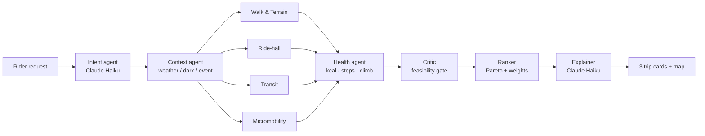

# Hopper — SF multimodal commute prototype

Uber-style trip planner that mixes **walk + ride-hail + Muni/BART/cable car + Bay Wheels**
in one trip, and ranks options by **time, cost, and health** (kcal, steps, climb).
San Francisco only.

## Run

```bash
cd hopper
PORT=5080 python3 -m app.server        # needs flask + anthropic
```

Open http://localhost:5080. With `ANTHROPIC_API_KEY` set, the Intent and Explainer agents
use Claude (`claude-haiku-5-5`); without it (or with `HOPPER_OFFLINE=1`) they fall back to
a rule parser and templates. Every number is identical in both modes.

Tests: `python3 -m pytest -q tests` (no network — live feeds are tested with sample payloads)

## Live data (free, no Google)

| Feed | Used for | Key | Fallback |
|---|---|---|---|
| **511 SF Bay** StopMonitoring + service alerts | Real Muni/BART/cable-car wait times; ⚠ alert flags on trips | `FIVE11_API_KEY` (free: https://511.org/open-data/token) | Schedule headway ÷ 2 |
| **NWS** api.weather.gov | Hourly forecast at the origin → rain/fog/clear, wind (> 20 mph turns bikes off) | none | Assume clear (or pick weather manually) |
| **Bay Wheels GBFS** | Real classic / e-bike counts and open docks at the nearest station | none | Deterministic pseudo-availability |

- Put keys in `hopper/.env` (see `.env.example`; git-ignored). Real env vars win.
- Live arrivals and docks are used only when the trip leaves **this hour** (SF time);
  future hours use schedules.
- 511's free tier is ~60 calls/hour: stop lists are cached on disk for a day, arrivals for
  90 s, alerts for 10 min; at most 4 arrival lookups per plan; a rolling budget
  (`FIVE11_HOURLY_BUDGET`, default 50) stops calls before 511 refuses them.
- `HOPPER_OFFLINE=1` turns off every live feed and Claude.
- The UI shows a weather strip and badges saying which sources were live for each plan.

## Agent swarm



- **LLM agents do language** (understand the request, explain the trade-off).
- **Deterministic tools do numbers** (`app/tools.py`): fares, minutes, calories, ranking,
  validation. The Critic rejects any leg whose numbers weren't produced by a tool.
- Specialists fan out in parallel. Moving the sliders re-runs **only the Ranker** (`/api/rerank`).
- The UI's "Agent swarm trace" panel shows each agent's model, latency, and tokens.

## Health math

- Walking: ACSM walking equation (net kcal, resting excluded), Tobler's hiking function for
  uphill/downhill speed, 0.762 m stride for steps.
- Cycling: MET 6.8 classic (plus hill load), 4.0 e-bike.

## Known limitations (prototype)

- Places are a fixed gazetteer of ~40 SF landmarks; legs are drawn as straight lines.
  Next step: OSM street routing (OSMnx/Valhalla) and geocoding.
- Transit routes are a hand-built subset of 7 lines with fixed segment times; single line
  per trip, no transfers. 511 supplies live waits and alerts, not routing. Next step:
  OpenTripPlanner 2 on 511 GTFS + OpenStreetMap (needs Docker or Java 21+).
- 511 direction matching uses the vehicle's destination stop; BART trains aren't filtered
  by branch (an SFO trip could see a Millbrae-only train's ETA).
- **Ride-hail prices are simulated** (base + mile + minute + fee × surge zone). No Uber/Lyft API.
- Bike dock availability is pseudo-random per hour (reproducible), not live GBFS.
- Hills use average grade between endpoints, which understates individual steep blocks.
- Booking is a mock confirmation; no rides are requested and no payment is taken.
